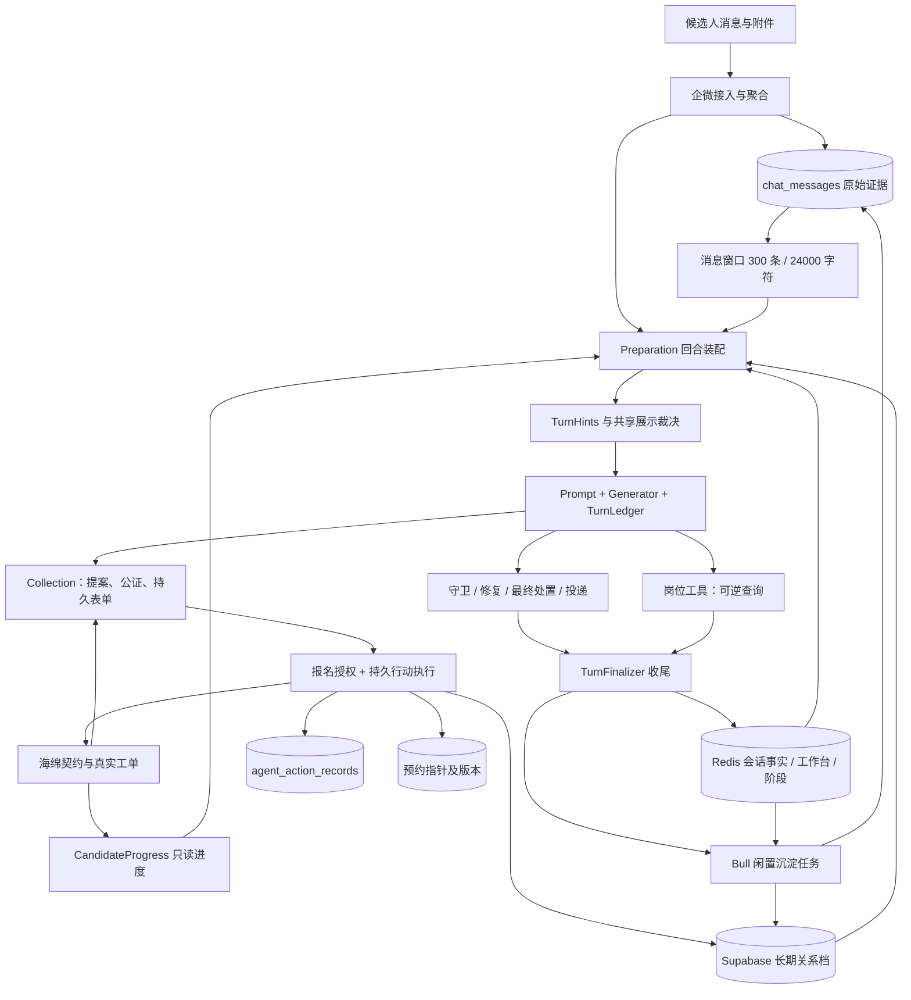
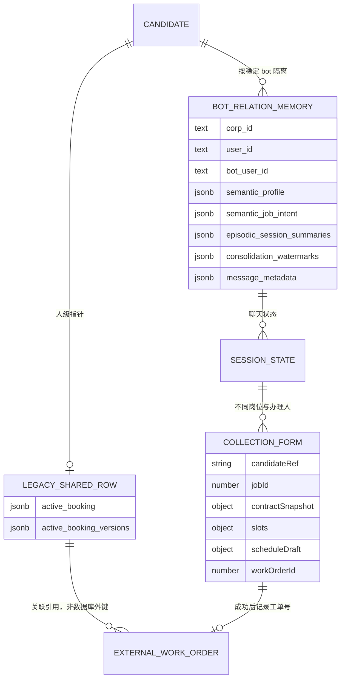
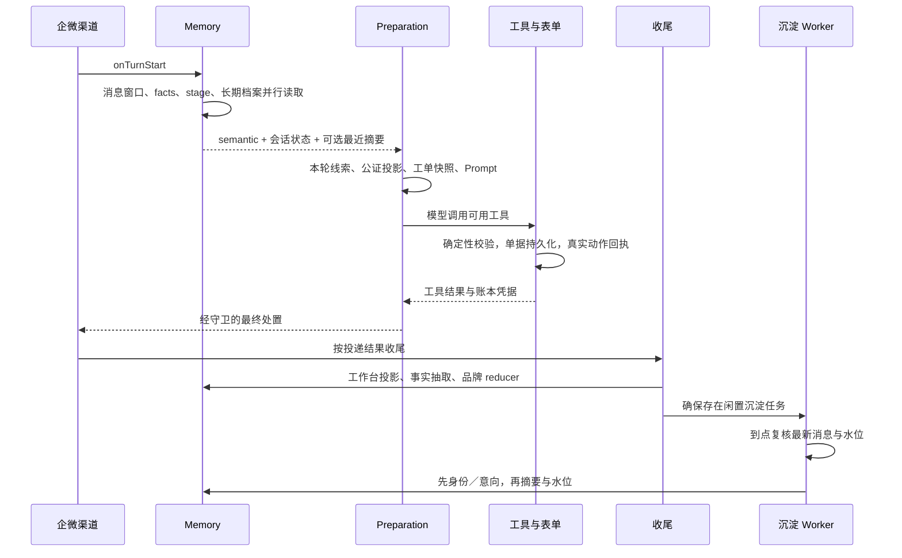
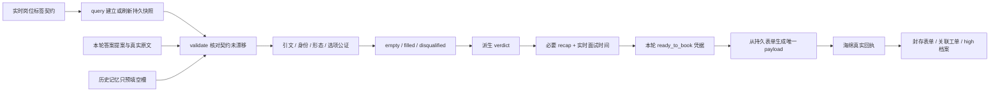

# 蛋糕记忆与候选人状态：设计、数据结构与运行机制

> 核查日期：2026-10-23。本文以 v11.14.1 已发布代码为基线；本地记忆、收资及 preparation 目录与该标签无差异。PR #1456 的测试基础设施改动不算生产行为。
> 面向产品、后端与 Agent 同事。运行数据和健康判断见[现状报告](../product/memory-system-status-2026-10-23.md)。示例都是虚构结构，不包含真实候选人。

## 1. 设计目标：按事实归属拆分状态

这套设计要同时满足四件事：对话能够连续、每个值能说明来源、报名动作不能被模型猜测驱动、重试与带外业务变化不能使旧状态复活。为此，不能用一份“大候选人 JSON”同时承担认知、办理进度和业务真相。

| 概念 | 回答的问题 | 权威写方 | 不代表什么 |
| --- | --- | --- | --- |
| 长期档案 profile | 这个人在本账号下已知的身份信息是什么 | 报名办结回写、闲置沉淀 | 不是已通过所有岗位筛选 |
| 求职意向 job intent | 最近明确的城市、岗位、班次等要求是什么 | consolidation | 不是永远不变的身份 |
| 会话事实 facts | 当前咨询中已采信了什么 | facts 服务、收资桥接、领域 reducer | 不是模型任意输出的复制品 |
| 会话工作台 workbench | 查过、展示过、正指代哪个岗位 | 工具结果与收尾投影 | 不是岗位系统实时库存 |
| 当轮账本 TurnLedger | 本轮真实查到／做过什么、有什么授权凭据 | preparation 创建，工具追加 | 不是持久动作底账 |
| 收资表单 collection form | 此人此岗已填哪几格，是否能提交 | collection form machine | 不是跨岗位通用档案 |
| 候选人进度 CandidateProgress | 现在有哪些工单，是否应停止推岗等 | 外部工单 + 指针的只读派生 | 不是新建一张业务状态事实表 |
| 行动许可 ActionPermit | 这个聊天此刻允许自动行动吗 | 聊天控制状态的判定 | 不是人级招聘进度 |
| 持久行动记录 agent_action_records | 某个外部动作到底执行到哪一步 | runtime action 执行／恢复流程 | 不是 Prompt 或会话记忆 |

`source` 说明信息怎么产生，`confidence` 说明记忆如何采信。代码公证只能证明引文、身份归属和形态符合规则，不能证明候选人陈述符合客观事实；报名成功的 high 也不等于线下证件核验通过。

## 2. 总体架构图



图中的表单和会话状态都使用 Redis，但所有权不同。`collection-form` 是在办单据，丢失会损失办理进度；消息 list 是可从数据库重建的缓存。运维不能把二者统一当作“可删缓存”。

## 3. 身份、范围与数据存储

### 3.1 四种键的范围

- **人**：`corpId + userId`，用于共享预约指针和人级工单关系。
- **人 × 托管账号**：再加稳定的 `botUserId`（企微 wecomUserId），用于长期语义记忆隔离。轮换的 `imBotId` 是渠道标识，不能代替主键。
- **聊天**：`sessionId = chatId`；这个技术 session 可以贯穿多次咨询。业务 episode 由连续闲置 7 天计算，没有第三层独立记忆库。
- **人 × bot × 岗位事务**：表单再加 `candidateRef + jobId`。手机号到达前可用 session 引用，确认后重绑；additional 候选人不覆盖 primary 指针。

### 3.2 长期表的实际数据库设计

2026-10-23 生产 schema 核查：`agent_long_term_memories` 共 13 列。

| 列 | 类型／可空 | 结构与职责 |
| --- | --- | --- |
| id | uuid，NOT NULL | 行标识 |
| corp_id / user_id | text，NOT NULL | 租户和候选人 |
| bot_user_id | text，可空 | 非空为 bot 关系行；空为 legacy 共享行 |
| semantic_profile | jsonb，NOT NULL | 9 字段身份信封对象；字段可 null |
| semantic_job_intent | jsonb，可空 | 11 个长期意向字段的稀疏信封对象 |
| episodic_session_summaries | jsonb，NOT NULL | 裸 SummaryEntry 数组，最多 20 段 |
| consolidation_watermarks | jsonb，NOT NULL | bySession 与 lastSettledMessageAt 工作水位 |
| message_metadata | jsonb，可空 | 跨系统关联与联系人快照 |
| active_booking | jsonb，可空 | 共享行中的工单指针及 bookings 列表 |
| active_booking_versions | jsonb，NOT NULL | 每工单 occurred_at／deleted 与 reset_at，防旧投影复活 |
| created_at / updated_at | timestamptz，NOT NULL | 行创建／变更时间，不能代替每个事实的时间 |

关系行唯一约束是 `(corp_id,user_id,bot_user_id)`。普通 PostgreSQL UNIQUE 允许多个 NULL，因此额外用 `(corp_id,user_id) WHERE bot_user_id IS NULL` 的部分唯一索引保证共享行唯一。另有 bot 关系检索、更新时间等索引。不能仅看到 bot_user_id 为 NULL 就认定应删除：共享工单、metadata、冻结旧记忆和水位均可能有价值。

JSONB 适合少量结构化字段与每候选人聚合读写；它不意味着无 schema。TypeScript/Zod、写入 RPC 与已验证 CHECK 共同约束。高频报表不要反复展开全历史 JSONB，应该用有界查询或预聚合。



这是**逻辑关系图**：BOT_RELATION_MEMORY 与 LEGACY_SHARED_ROW 是同一物理表的两种行；SESSION_STATE 和 COLLECTION_FORM 在 Redis；海绵工单属于外部系统，不存在图示所暗示的本地外键事务。

### 3.3 Redis 与内存结构

以下 key 省略环境前缀，生产实际有命名空间隔离。

| Key／对象 | 结构 | 默认物理 TTL／上限 |
| --- | --- | --- |
| memory:short_term:chat:{chatId} | List 消息缓存，回源原子重建；追加用 RPUSHX | 7 天；300 条；消费再裁 24,000 字符 |
| factsv2:{corpId}:{userId}:{sessionId} | Hash：facts、工作台、invitedGroups、terminal、两个消息水位 | 7 天 + 12 小时 |
| stage:{corpId}:{userId}:{sessionId} | JSON currentStage | 实际为 7 天 + 12 小时，与 Hash 同步续期 |
| long-term:{corpId}:{userId}:{botUserId} | 长期行缓存 | 2 小时；写入后失效 |
| collection-form:{corpId}:{userId}:{botUserId}:{candidateRef}:{jobId} | BookingCollectionForm 完整快照 | 7 天 |
| collection-form-primary / current | 主候选人／活动候选人定位指针 | 7 天 |
| BookingSnapshot 缓存 | 工单列表、本人校验、fetchedAt，另有候选人镜像 | 5 分钟；fresh 场景穿透 |
| TurnHints / TurnLedger / promptBlocks | 当轮线索、只读快照、模型上下文 | 一轮内存，无独立持久层 |

`stage` 的业务口径仍是 7 天，但当前 `setStage()` 用 sessionFactsTtl，Hash patch 以 Lua 同步 expire 已有 stage；不存在时不会重建。这是本次发现并修正的旧文档“stage 严格 7 天”漂移。

## 4. 事实数据结构与变更语义

### 4.1 身份档案

九键为 `name / phone / gender / age / is_student / education / has_health_certificate / height / weight`。其中学生为 boolean，其他身份数值在现有契约中仍以规范字符串表示；身高 cm、体重 kg。不能把存量已经是 kg 的值再次换算。

```json
{
  "has_health_certificate": {
    "value": "办理中",
    "confidence": "medium",
    "source": "candidate_quote",
    "evidence": "候选人明确表示正在办理",
    "updatedAt": "2026-10-23T08:00:00.000Z",
    "originSessionId": "example-chat",
    "originBotId": "example-channel-bot"
  }
}
```

来源闭集：`candidate_quote / rule / model / system / manual / archive`。长期使用 updatedAt，短期信封使用 extractedAt 等原始时间，沉淀不应该把旧事实刷新为“现在说的”。evidence 限 200 Unicode 码点，完整原话回到聊天和 trace。

表单逐格落定通常回写 session medium，社会身份 is_student 例外 high；报名成功的身份写 session／长期 high。沉淀由 session interview_info 提拔长期身份，通常压为 medium。RPC 同时检查置信等级和时间：低置信不能盖 high，陈旧值不能盖新值；这不是“所有字段最新值无条件胜出”。

### 4.2 求职意向与墓碑

长期 11 键：`city / district / location / brands / position / schedule / salary / labor_form / schedule_constraint / delayed_intent / available_after`。临时 `short_term / time_windows / open_position` 不照搬进长期集合；brand_ids 不再持久化，品牌 reducer 仍保存自己的当前品牌状态。

意向使用字段级时间合并：字段缺席代表未更新；信封内 value=null 是有时间的显式墓碑；值存在则替换该字段而非拼接旧数组。旧任务晚执行时仍按原事实时间比较。换城市会清除不应继承的旧区域和商圈；时间更新的依赖字段受到保护，同轮新区域可以随后写入。

`schedule_constraint` 在短期写入时有自己的结构化 patch：未提供的子字段延续，null／空数组／false 可撤销对应条件；不能用“意向每字段替换”误解其内部子字段语义。

`available_after.date` 早于业务今天就过期；`delayed_intent.until` 有有效日期时先按该日期判断，缺有效日期时用 extractedAt／updatedAt 的 30 天期限。读取、沉淀和清洗复用同一规则，避免过期事实从旧快照复活。

### 4.3 健康证与 metadata

健康证值与收资表单四态同源：有本地有效／无但接受办理／无且不接受办理／办理中。别名只做已核查的精确归一；“有、true、异地、过期”不足以推出本地有效性或办理意愿，归不到四态则 null。optionCode 仍来自实时岗位契约。

`message_metadata` 可含 botId、imBotId、imContactId、contactType、contactName、externalUserId、avatar；是扩展关联，不是 source/evidence。当前不会因纯读取预建壳行，实际长期写入可合并已知 metadata。历史回填只补空并沿会话血缘验证本人和 bot；消息表没有 bot_id，不能猜造 botId。

RPC 对传入 metadata 对象执行去 null 后合并，因此“本轮清洗不覆盖已有值”和“所有运行时 metadata 永远不可更新”是两回事。它也不是账号间共享 profile 的许可。

## 5. 一轮对话到长期沉淀



回合开始的最近摘要只在会话缺失或距离上次已满沉淀间隙的回访首轮提供，正文最多 300 码点；连续回合不重复加，更多历史由 recall_history 拉取。Prompt 展示可以含待确认信息，工具默认只 unwrap high 的长期身份；消费门槛不同是有意设计。

回合末按最终投递结局处理，不能把未真正发送的助手内容投影成已告知候选人的事实。岗位池、焦点、已展示岗位分别维护；池中前 10 条保留完整摘要、后 20 条精简，裁剪不会用“忘记已展示”来换空间。

闲置任务复用未到期任务，到点再依据数据库最新候选人消息确认是否真正闲置；不能只根据旧 job 的计划时间沉淀。原文扫描有最多 10 页 × 500 条预算，摘要输入取尾部最多 120 条，并保留覆盖不全说明。

沉淀产生三种输出：身份守卫合并、意向字段时间合并、经历摘要追加淘汰。profile／intent 在同一 RPC／行锁中写；摘要和水位另一次原子更新。求职段写事实与摘要；非求职段可写有据事实、不新增摘要；无实质内容段直接推进水位并返回，不执行本次事实提拔。后两种都不新增摘要。不是跨 Redis、模型调用与 Supabase 的一个全局事务。

## 6. 报名表单：认知如何变为可提交资料

`BookingCollectionForm` 保存 `candidateRef / jobId / contractSnapshot / slots / scheduleDraft / lastRecap / workOrderId / escalatedReason` 等。slots 以契约 labelId 为键；filled 携带 value、optionCodes、sourceText、producer，不另存一套置信等级。整个表单与定位指针由 tools 域维护。



query 只刷新契约、不偷偷消费答案；validate 遇实时契约与快照不一致返回 contract_changed。无旧快照时当前实现可以同次先建快照再校验，不必先空跑 query。候选人模型提案、模板回捞、确定性适配均汇入同一写槽入口。

公证验证引文确实来自本轮真实消息、短答与真实问句绑定、身份归属、值形态、optionCode 属于契约；不让模型自带“证据文本”取代 runtime 原文。筛选只以契约 rejectedOptions／valueSpec 为准，说明文字不自动变为筛选规则。

槽位 empty／filled／disqualified 是持久状态；`collecting / disqualified / ready / escalated / submitted` 是 `verdictOf()` 现算结果，不另落盘。明确候选人表达经公证后不一律重复确认；外部 archive/system/manual 预填需要条件式 recap。面试时间在 scheduleDraft 单独保存，每轮按实时可约时段复验。

booking 要求本轮 ready_to_book、真实召回岗位和有效表单。外发 payload 只有 `{jobId, interviewTime?, labelList}`，来自持久表单，不能从模型随手拼的姓名／手机号旁路提交。后端 errorList 按 labelId 精确重开，失配转人工；成功但缺工单号也不能盲目重提。

## 7. 候选人状态不是一个枚举

### 7.1 五种“状态”必须分开

1. **stage**：当前会话策略阶段。存储缺失返回 null；新咨询通常兜底 trust_building，已有档案等上下文可能参与上层策略，不能从 key 不存在推导“什么也没做”。
2. **terminal**：会话停发／终态提示，旧值可读 booked、handed_off、rejected、onboarded；候选人进度收口后新写入口只允许 booked。历史兼容不等于仍鼓励新写全部枚举。
3. **表单 verdict**：这张报名单现在能否推进。
4. **候选人进度**：人级真实工单和关联，值有 yes／no／unknown；unknown 必须保留未知。
5. **行动许可**：本聊天是否托管、暂停或被人工接管。A 账号接管不能自动使 B 账号失去行动许可。

### 7.2 进度如何进入上下文

`BookingContextLoaderService` 优先按本人手机号通过 BookingSnapshot／CandidateProgress 读海绵快照。没有本人手机号、token 不可用或查询失败时，回落 active_booking 指针逐工单查；并补查近时新指针，覆盖外部查询与本地写入的并发窗口。它负责读视图装配，不在这里排提醒或写终态。

快照包含 signupSource（AI／SUPPLIER）、ownedByCandidate（姓名核对）、fetchedAt 等。本人校验不通过的工单可以展示但不能用于放行取消／改约等动作。跨账号数据未提供账号归属时 ownedByCurrentAccount 为 unknown，缓存键不能充当归属证据。

带外工单也会影响进度：人工在供应商后台建单后，后续查询及渠道侧核对可看到；不是只有 AI 自己写的 active_booking 才算候选人已报名。邀请记录也不是实时群成员核验：视图明确 verified=false。

### 7.3 当前仍是 legacy 多窗口

| 消费者 | 当前规则摘要 |
| --- | --- |
| 回合上下文 | 约面两态且报名不超过 15 天或面试在未来；近 30 分钟指针补查 |
| 预检／报名查重 | 同岗位／同品牌规则与严格小于 30 分钟近期同岗规则 |
| 复聊带外核验 | 约面超过面试时间 3 天放行；面试通过 30 天内停发；上岗停发 |
| 报名后提醒到点 | 约面两态，无同样的时间窗 |
| 清 booked 前检查 | 约面两态及面试成功，无时间窗 |

规则已集中在 `legacy-progress.policies.ts`，但还没有批准统一窗口。`candidate_progress_difference` 用同一批工单比较 context／proactive／openWithoutWindow，只观测、不自动切换。短期内应如实把“集中治理”与“业务口径统一”分开。

### 7.4 动作恢复与预约版本

`agent_action_records` 是外部动作的持久记录能力，和一轮内存 TurnLedger 不同。部署默认 ACTION_EXECUTION_MODE=observe：观察记录不等于执行凭据，也不会据此跳过原有调用；execute 才启用对应执行保护。本次没有核验生产实时开关，因此这里只描述代码能力，不宣称生产已启用 execute。预约指针保留 work_order_id、linked_at、job_id 和已提交的 interview_time；后者是提交时快照，工单当前面试时间仍以海绵查询为准。

`active_booking_versions` 按工单保存 occurred_at／deleted，另有 reset_at。投影 RPC 采用行锁、原事件时间、成功行动记录检查与墓碑；过期恢复不能重新添加已经被更新取消的预约。同版本删除优先于 set，较新工单不被旧 reset 清掉，活动列表当前封顶 10 项，版本墓碑不能随列表裁剪随便丢弃。

## 8. 健康评估与文档维护结论

最新 34,916 行中现有 CHECK 违规 0；bot 关系档身份非空覆盖 10.80%、意向 42.03%、摘要 52.72%。这描述存储构成，不是识别准确率或转化率。metadata 空 2,017 行，其中 2,012 行是 legacy、当前 bot 关系行 5 行，属于关联信息遗留。健康证未知的 19,286 个 bot 关系行包含尚未进入收资的情况，不能据此认定漏采或故障；应按应采集人群另行评估，不用猜测填满。

本轮发现并更新的项目说明：候选人档案 3 天旧 TTL、stage 物理 TTL、摘要纯工具消费、意向整组覆盖、摘要二态、收资缺快照须先 query、实施记录仍称生产未迁移等。架构文档新增指向 CandidateProgress 与版本保护的入口。

个人知识库同步情况：

| 内容 | 核查结论与处理范围 |
| --- | --- |
| 状态所有权、权威来源与生命周期 | 保留原论述，补齐 CandidateProgress／行动许可、stage 物理 TTL 和当前边界 |
| 收资、事实与记忆：证据与冲突裁决 | 将整组覆盖改为字段时间合并；补 metadata、四态、首轮摘要与三态沉淀 |
| 收资与预约事务状态机 | 补齐只读进度入口、表单和业务真相分离、指针版本保护 |
| Excalidraw 图谱与交互 HTML | 后续已原位同步 05／11／12／13／14 五张可编辑图，保留布局并补齐当前语义；其余图与旧交互 HTML 未全面重审 |

未来应先量化发布后抽取成本、沉淀积压、首轮摘要使用效果和多窗口差异，再决定替换模型、移出会话锁、统一候选人进度时间窗。已有约束和 5 条业务回归不足以证明全业务健康；对于表单丢失、外部状态未知、行动恢复异常，需要独立告警与证据链。

## 9. 可核查实现入口

- [Memory 规范](../../src/memory/README.md)、[配置](../../src/memory/memory.config.ts)、[长期类型](../../src/memory/long-term/long-term.types.ts)、[短期类型](../../src/memory/short-term/short-term.types.ts)。
- [生命周期](../../src/memory/lifecycle.service.ts)、[沉淀](../../src/memory/long-term/consolidation.service.ts)、[时效事实](../../src/memory/temporal-facts.ts)、[健康证四态](../../src/resolution/candidate/health-certificate-state.ts)。
- [表单域设计](collection-form-machine.md)、[表单结构](../../src/resolution/collection/form.types.ts)、[当轮账本](../../src/agent/generator/preparation/turn-ledger.ts)。
- [候选人进度](../../src/biz/candidate-progress/README.md)、[进度服务](../../src/biz/candidate-progress/services/candidate-progress.service.ts)、[上下文装配](../../src/agent/generator/preparation/booking-context-loader.service.ts)。
- [事实完整性迁移](../../supabase/migrations/20261023160000_memory_fact_integrity.sql)、[预约投影版本](../../supabase/migrations/20261021130000_version_booking_projections.sql)、[持久行动记录](../technical/runtime-action-records.md)。

文档是实现的解释，不能反过来覆盖代码或证明生产变更完成。本次只修改说明材料，不更改业务逻辑、生产数据、发布状态或 PR 审批策略。
