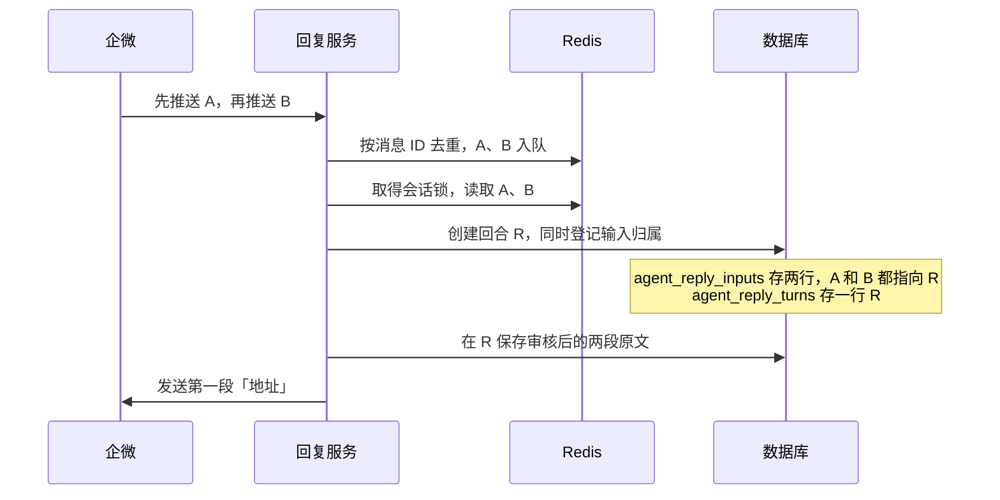
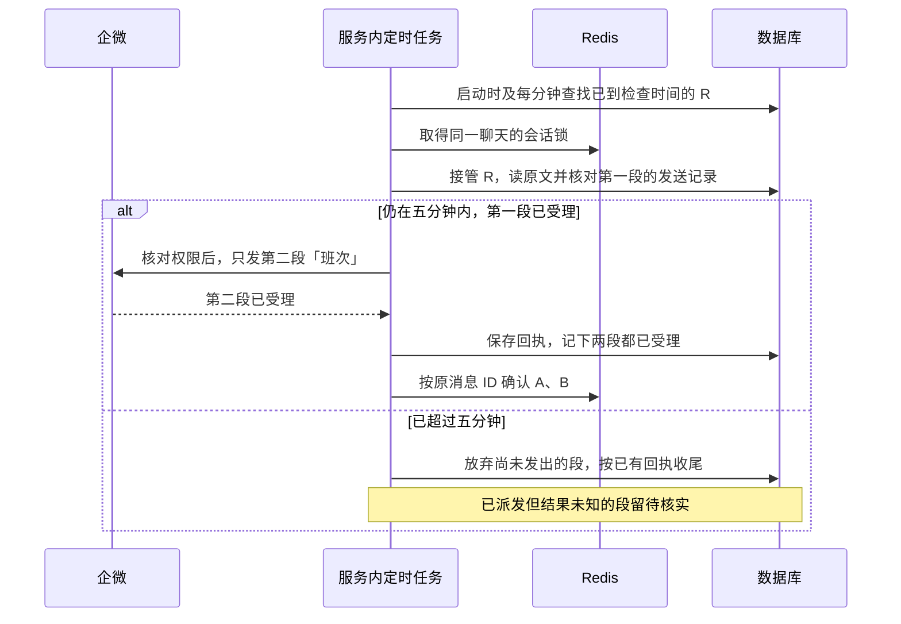

# 企微消息服务架构

**最后更新** 2026-11-26

企微按消息推送，Cake 按回合组织回复，企微按分段受理发送。候选人连发两条提问，可以只生成一次回复，再发出两段文本。回调应答告诉托管平台「消息已收到」，企微的发送结果告诉 Cake「这一段已受理」，最后的队列确认才移除本轮处理过的输入。[Agent 运行时架构](agent-runtime-architecture.md) · [消息处理数据流](../workflows/wecom-message-dataflow.md) · [回复模块实现](../../src/biz/reply-execution/README.md)

## 主聊收发时序

以下时序描述开启聚合的主聊执行回合。普通回复按段续发需要回合恢复和分段领取两个数据库函数。本批和消息排障一起发布时，五份迁移交错执行，随后部署配套应用。[联合发布顺序](../technical/runtime-storage-batch.md#发布顺序)

### 两条提问合成一轮回复

候选人连发 A「门店在哪？」和 B「几点上班？」。两条提问都在 `execute` 切换时间后进入同一个聊天。入口按消息 ID 去重。等候选人停下来，处理任务获得会话锁，读取 A、B，并在调用模型前把它们登记为回合 R。

如果企微随即重推 B，入口的去重键会拦下重复回调。正常投递时，系统保存审核后的两段原文，先发地址。企微明确受理第一段后再发班次。两段均已受理，回合保存发送结果，系统只确认 A、B。生成过程中后来到达的 C 仍在待处理列表里，可以形成下一轮回复。

### 第一段发出后服务重启

假设地址已经发出，班次尚未派发。恢复任务由企微消息模块注册，和接收消息的接口运行在同一个 Cake 进程。所有实例停机时，定时检查也暂停。启动时先查一次，此后每分钟从 `agent_reply_turns` 取出 `next_check_at` 已到的主聊执行回合，每轮最多 25 条。即使 Redis 待处理列表已经过期，也能找到 R，无需候选人或企微再次发送 B。[调度入口](../../src/channels/wecom/message/delivery/reply-recovery.service.ts) · [查询条件](../../src/biz/reply-execution/reply-turns.repository.ts)

**三个时间各管什么？** 原处理进程每分钟向数据库续租。以 10:00 开始发送、之后宕机为例，10:03 原租约到期，恢复任务可以接手。10:04 恢复时，若地址已受理，只向原聊天发送班次。若到 10:05 以后才接手，就放弃班次，按地址已受理收尾。截止时间从原进程最后一次成功保存分段、开始投递或续租算起。后台扫描和接管不会延长它，每段实际发出前还会复核。

若企微是否受理地址仍未知，后续分段先等。截止时仍查不到可信结果，就保留已确认的连续段数，记录待人工核实。晚到回执归原请求，不能重新启动班次投递。若两段都已受理，服务可以在截止后继续写岗位记忆、补办跟进和确认原输入。

这轮如果还需要候选人补资料或确认资料，恢复任务按原预检结果安排相应跟进。如果回复承诺转人工，工单登记和飞书通知各有凭证。即使工单早已建好，服务也会查通知是否获受理。受理凭证和任务入队成功后才确认原消息。

排障数据随回复分两次落地。保存审核后的回复时，主流水、回合快照和逐次模型 HTTP 原文一起提交。企微分段结算时，数据库同步更新该流水的处理结果和实际受理段数。恢复任务沿用原来的处理 ID。[回合存储](../../src/biz/reply-execution/README.md) · [写入与结算](../../supabase/migrations/20261125100000_ordinary_reply_segment_io.sql)

自动续发从保存最终分段开始。若服务在模型生成期间中断，或旧回合没有保存分段，恢复任务只能根据已有业务记录收尾。业务结果无法确认时转人工核实。群任务与复聊按各自的任务流程恢复。[群任务与复聊恢复](../technical/runtime-scheduled-actions.md)

**候选人下一轮能接着聊什么，也取决于分段回执。** 假设两段分别介绍东门店和西站店。只有东门店那段获企微受理时，岗位记忆只登记东门店。重启后西站店那段也获受理，下一轮就能读到两家门店，这次推荐仍只算一轮。如果恢复的是首次私聊开场白，整条回复受理后，系统补记开场事件，按原回合输入时间排一次「开场后未回复」跟进。任何一步暂时写不进去，回合留待重试，完成后才确认原输入。[岗位记忆](../../src/memory/short-term/workbench.service.ts) · [开场与跟进收尾](../../src/channels/wecom/message/application/reply-workflow.service.ts)

## 1. 分层与职责

| 层 | 核心实现 | 职责 |
| --- | --- | --- |
| 接入 | `ingress/`、`MessageService` | 归一化企业和小组回调。普通入站快速应答，纳管发送回调先验证来源和请求归属。 |
| 编排 | `application/`、`AgentRunner` | 准入、历史与图片准备、生成与守卫，按最终结果选择回复、沉默或转人工。 |
| 队列 | `runtime/` | 管理待处理输入、静默窗口、工作并发和会话锁。 |
| 持久回合 | `biz/reply-execution` | 登记输入归属与回合执行权，保存待发分段、结局和待补办事项。 |
| 投递 | `delivery/`、`biz/action-execution` | 校验当前权限，分段交给企微，记录每段受理凭证。服务内定时任务按原回合恢复。 |
| 观测 | `telemetry/` | 记录 trace、处理流水、耗时、token 与工具执行情况。 |

## 2. 核心服务

| 服务                                                                                                                  | 当前职责                                                       |
| --------------------------------------------------------------------------------------------------------------------- | -------------------------------------------------------------- |
| [MessageService](../../src/channels/wecom/message/message.service.ts)                                                 | 普通回调异步分派，验证并匹配纳管发送回执                              |
| [AcceptInboundMessageService](../../src/channels/wecom/message/application/accept-inbound-message.service.ts)         | self 消息归档、过滤、去重、历史和图片准备                      |
| [ReplyWorkflowService](../../src/channels/wecom/message/application/reply-workflow.service.ts)                        | `runInboundTurn`、有界 replay、最终副作用、投递、TurnFinalizer |
| [SimpleMergeService](../../src/channels/wecom/message/runtime/simple-merge.service.ts)                                | Redis pending list、静默窗口 delayed job、租约锁与 follow-up   |
| [MessageProcessor](../../src/channels/wecom/message/runtime/message.processor.ts)                                     | Bull 消费者、chat 串行、锁心跳                   |
| [MessageRuntimeConfigService](../../src/channels/wecom/message/runtime/message-runtime-config.service.ts)             | 托管配置快照与聚合/投递/模型选择                               |
| [MessageDeliveryService](../../src/channels/wecom/message/delivery/delivery.service.ts)                               | 最终文本分段、延迟和发送失败聚合                               |
| [ReplyTurnsService](../../src/biz/reply-execution/reply-turns.service.ts) | 持久化输入归属、原回复分段、执行权和投递结局 |
| [DurableReplyDeliveryService](../../src/channels/wecom/message/delivery/durable-reply-delivery.service.ts) | 通过动作执行器核对各段状态，按原请求身份派发 |
| [ReplyRecoveryService](../../src/channels/wecom/message/delivery/reply-recovery.service.ts) | 服务内定时检查到期回合，处理续发、本地收尾或人工核实 |
| [WecomMessageObservabilityService](../../src/channels/wecom/message/telemetry/wecom-message-observability.service.ts) | batch trace 与消息流水的阶段打点                               |

## 3. 入站与快速 ACK

`POST /message` 归一化企微回调。普通入站尽快返回接收成功，历史写入、模型处理和回复发送随后执行。小组 `execute` 输入先核实路由身份。属于 Cake 发送请求的自发回调，验证来源后按原请求匹配并写入可信凭证，再返回接收成功。发送接口已明确受理的分段可以继续，无需等待自发回调。[渠道回调入口](../../src/channels/wecom/message/message.service.ts)

1. 入口处理自发消息并过滤来源、联系人、托管状态、黑名单、群聊、消息类型等条件。需要留档的消息写入渠道历史。
2. 对准入的入站消息，Redis 以 `messageId` 执行 `SET NX EX`。同一 ID 在有效期内只进入一次处理。
3. 对需要分派的消息创建 trace 和 intake 流水，按需准备图片，异步写入 `chat_messages`。AI 回复开启时，按配置进入聚合队列或直接处理单条消息。

## 4. Debounce 与租约锁

每条消息追加到 Redis 待处理列表，刷新最后消息时间，并安排 Bull 延迟检查。工作任务取得会话锁后复核静默窗口。窗口尚未结束或锁被占用时，安排下一次检查。窗口到期后用 `LRANGE` 读取当前列表，读取时保留消息。处理结束才按本轮实际接纳的 `messageId` 从列表移除对应项。未参与本轮的新输入留给后续任务。[列表读取与确认](../../src/channels/wecom/message/runtime/simple-merge.service.ts) · [工作任务](../../src/channels/wecom/message/runtime/message.processor.ts)

### 4.1 锁与回合执行权

聚合任务和恢复任务使用同一把按 `chatId` 区分的 Redis 锁。聚合工作进程获得 90 秒租约，持锁期间每 30 秒用自身令牌续期，锁冲突后安排 30 秒重检。待处理列表有 300 秒有效期，重检时可续期。数据库另按回合校验执行权。即使其他实例已取得聊天锁，也要等原回合的数据库租约到期，才能接管未完成的投递。

### 4.2 Worker 并发

企微的 `message-merge` 队列按实例限制同时领取的任务数。`system_config` 中的 `workerConcurrency` 可设 **1 至 100 的整数**，缺省 4。实例启动时按保存值注册 Bull 消费者。同一个聊天的任务仍要取得同一把 Redis 锁。[配置读写](../../src/biz/hosting-config/services/system-config.service.ts) · [消息处理](../../src/channels/wecom/message/runtime/message.processor.ts)

例如，后台将 20 改成 50。保存成功后，接收请求的实例立即停止领取新任务，继续完成已领取的任务。新消息照常入队。旧消费者排空后，新消费者按 50 个槽领取任务。其余实例每 30 秒读取一次共享配置，按相同步骤调整。切换中再次修改时使用最后保存的值。[切换与排空](../../src/channels/wecom/message/runtime/message-worker-manager.service.ts)

后台和 `GET /message/worker-status` 分别显示已保存目标 `concurrency`、本实例已注册槽数 `registeredConcurrency` 和正在处理的任务数 `activeJobs`。排空或准备连接时，已注册槽数为 0，处理中可以大于 0。消费者取得 Redis 对阻塞连接的登记回执后才上报新槽数。上例完成时前两个数都为 50。Upstash 每个槽用独立阻塞连接领取任务，另共享普通命令和订阅两条连接，50 槽共用 52 条消费者连接。普通 Redis 用一个 Bull 消费者注册目标并发。[消费者连接](../../src/channels/wecom/message/runtime/message-worker-consumer.ts) · [后台面板](../../web/src/view/config/list/components/WorkerPanel/index.tsx)

## 5. Agent、Outcome 与 replay

`ReplyWorkflowService` 调用 `AgentRunnerService.runInboundTurn()`，取得渠道无关的 `TurnOutcome`。每次生成都带有 `runTurnEnd`，由渠道包装为 `TurnFinalizer`，在投递结局确定后结算。

已登记的 `execute` 回合固定本轮输入。假设 A、B 已归到 R，此后到达的 C 留给下一批。未建立持久回合的路径，才会在生成后查看新输入，必要时丢弃尚未投递的版本，合入新消息再生成，最多重放 3 次。

是否允许重放取决于 outcome、待提交的副作用和工具动作凭证。预约或邀请等动作已经成功、仍在执行或结果未知时，保留当前版本。工具在实际派发前发现新输入并中止，且此前没有阻止重放的动作凭证时，可以吸收新消息。[回合编排](../../src/channels/wecom/message/application/reply-workflow.service.ts) · [重放判定](../../src/agent/runner/turn-outcome.ts)

## 6. 最终副作用、投递与 TurnFinalizer

渠道按最终 `TurnOutcome` 执行。`reply` 经审核、分段和权限检查后发送，`skipped` 结束本轮，`handoff` 按业务意图转人工。与回复绑定的人工跟进工单在投递结局确定后，按原工单幂等键提交。发送接口返回 `errcode=0` 表示企微已受理该段，候选人是否已读仍是未知。[投递实现](../../src/channels/wecom/message/delivery/delivery.service.ts) · [各段受理凭证](../../src/channels/wecom/message/delivery/durable-reply-delivery.service.ts)

普通文本每段首次发送成功需要两次数据库往返。路由、会话锁和托管权限检查结束后，一次数据库请求同时核对回合并领取分段。企微受理后，一次请求保存本段回执和动作结果。两段合计四次，整轮结果另写一次。服务在两段之间重启时，恢复任务按已受理的段接着发。[分段读写与代码入口](../../src/biz/reply-execution/README.md#发一段文本要等几次数据库)

`TurnFinalizer` 对丢弃的生成版本调用 `discard()`，对最终版本调用 `settle(...)`。部分受理时使用实际受理的文本更新助手记忆，零受理时仍可吸收用户事实。主处理路径在释放聊天锁前等待 `whenSettled()`。[记忆收尾](../../src/agent/runner/turn-finalizer.ts)

## 7. 运行时配置

| 来源             | 内容                                                                     | 生效方式       |
| ---------------- | ------------------------------------------------------------------------ | -------------- |
| 环境变量         | AI/聚合默认开关、去重 TTL 等启动配置                                     | 重启           |
| `system_config`  | `initialMergeWindowMs`、typing、WeCom 模型与 thinking | 运行时快照刷新 |
| `system_config`  | `workerConcurrency` | 启动按保存值注册，修改后排空并重新注册 Bull |
| 代码常量         | pending TTL、锁租约/心跳、follow-up 最小延迟、replay 上限                | 发版           |

托管配置的 `initialMergeWindowMs` 默认 3 秒。配置尚未加载时，消息服务的 `mergeDelayMs` 初始值为 2 秒。[托管默认配置](../../src/biz/hosting-config/types/hosting-config.types.ts) · [配置读取](../../src/channels/wecom/message/runtime/message-runtime-config.service.ts)

## 8. Redis 与回复表的分工

| 处理时要回答的问题 | 数据放在哪里 | 为什么读取 |
| --- | --- | --- |
| 这条消息刚刚推过吗？ | Redis 消息去重键，按 `messageId` | 短时间重复推送在入口结束。有效期默认 5 分钟，可配置。 |
| 这个聊天有哪些输入待处理，谁可以处理？ | Redis 待处理列表、最后消息时间和会话锁，均按 `chatId` | 聚合任务等待静默窗口，恢复任务与聚合任务争用同一把锁。 |
| 一条输入属于哪一轮？ | `agent_reply_inputs`，每条被接纳的消息一行 | 以企业、机器人账号、聊天、消息 ID 找回合。A、B 各有一行，都指向 R。 |
| 这一轮有哪些输入，做到哪一步？ | `agent_reply_turns`，每个回合一行 | R 保存原输入 ID 集合、执行权、待发分段、续发截止时间、结局和下次检查时间。即使重新处理时只看到 B，也能找全本轮应确认的 A、B。 |
| 某一段是否已交给企微？ | `agent_action_records` 保存发送动作当前状态，`agent_action_evidence` 保存各次派发的凭证 | 恢复任务按原动作核对该段，决定跳过、继续发送或等待回执。 |
| 当时聊了什么，工具返回了什么？ | `chat_messages` 保存渠道历史，`message_processing_records.tool_calls` 保存本次处理的工具调用 | 查看会话读取渠道历史，处理详情读取流水。 |
| Cake 为这一轮准备了什么，供应商实际返回了什么？ | 每条流水至多一份 `message_processing_turn_snapshots`，每次捕获的模型 HTTP 请求各有一行 `message_processing_invocations` | 总部按处理 ID 看上下文，按调用 ID 看单次收发原文。续发只依赖回复回合和动作回执。[排障表与字段](monitoring-system-architecture.md#消息处理的三张表) |

Redis 的键名和 TTL 见数据模型。输入归属的联合主键、回合状态迁移、恢复查询和代码入口见回复模块实现。[Redis 数据模型](../db/redis-schema.md) · [持久回合的读写实现](../../src/biz/reply-execution/README.md)

## 9. 运行时不变量

1. 普通入站快速确认，匹配的可信发送回执在返回前持久化。
2. 待处理输入按本轮接纳的原消息 ID 确认，后到的消息留给下一轮。
3. chat 锁必须用 owner token 条件续期/释放，并在长回合中持续心跳。
4. replay 只丢弃未投递且允许重放的版本。已经提交外部动作或仍在等待其结果时，保留当前版本。
5. outcome 副作用只在 replay 定局后提交。
6. 助手记忆使用实际受理的回复文本。主处理路径在释放聊天锁前等待本轮记忆结算。
7. trace/监控失败不能改变业务投递终态，但必须留下可诊断日志。
