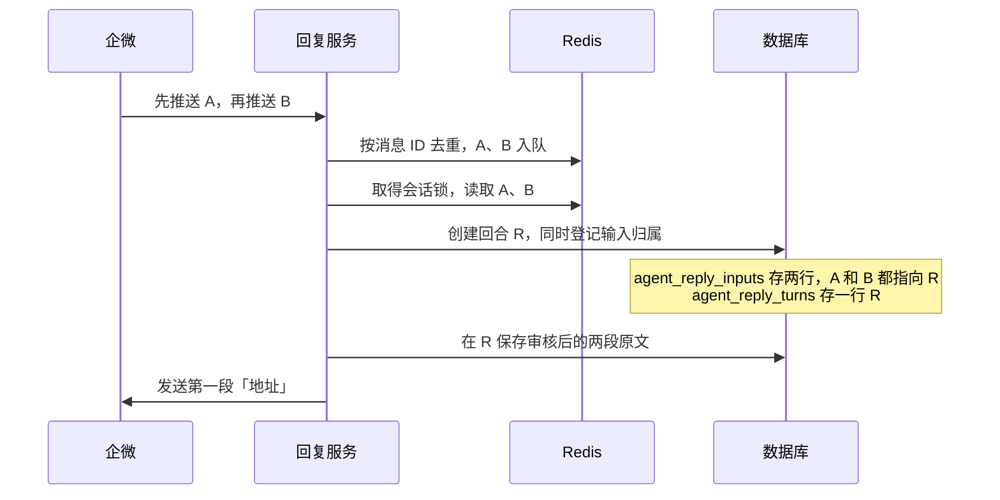
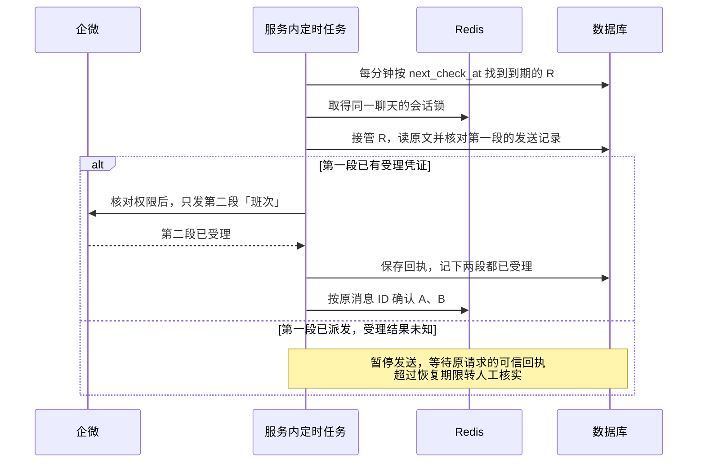

# 输入归属与回复结局

候选人连续发两条消息，系统可以合起来回复一次，这就是一个**回复回合**。主聊在 `ACTION_EXECUTION_MODE=execute` 下处理切换时间后的新输入时，Redis 负责入口去重和队列调度，PostgreSQL 保存输入归属和回合进度。处理消息的进程会查这两张表来决定下一步，运营也可以事后查看本轮结局。

## 普通回复

### A、B 怎样合成一次回复

候选人连发 A「门店在哪？」和 B「几点上班？」。系统把这两条提问一起交给模型，回复分为「地址」和「班次」两段。箭头从上往下读。

如果企微随即重推 B，Redis 去重键会在入队前拦下。正常发送时，每段使用原回合和段序号生成的请求号。企微受理「地址」后，系统记录回执，再发「班次」。[登记输入与回合](../../../supabase/migrations/20261125080000_resume_ordinary_replies.sql) · [发送前保存分段](../../channels/wecom/message/application/reply-workflow.service.ts)

### A、B 合并回复，发完第一段时宕机

假设「地址」已经发出，「班次」还没发，原进程宕机。图中的**服务内定时任务**由 Cake 的企微消息模块注册，与接收企微消息的接口运行在同一个 Node.js 进程。所有 Cake 实例都停机时，检查也暂停。实例重新启动后，定时任务会在下一轮检查已到期的回合，无需企微再次推送 B。[企微消息模块](../../channels/wecom/message/message.module.ts) · [每分钟的恢复任务](../../channels/wecom/message/delivery/reply-recovery.service.ts)

每分钟的查询从 `agent_reply_turns` 取 `mode = execute`、带主聊输入上下文（`recovery.primary`）且 `next_check_at` 已到的回合，按检查时间从早到晚最多取 25 条。任务取得 Redis 会话锁后，结合回合的 `status`、已保存的分段和数据库执行权，决定续发、补本地确认或通知人工。即使 Redis 待处理列表已过期，任务也能用这次查询找到 R。[到期回合的查询条件](reply-turns.repository.ts) · [会话锁](reply-recovery-lease.service.ts)

待发原文来自 `agent_reply_turns`。每段的发送状态在 `agent_action_records`，原请求的回执在 `agent_action_evidence`。恢复任务沿用原文，跳过模型生成和预约工具。企微发送接口返回 `errcode=0` 表示渠道已受理，候选人是否已读仍是未知。[逐段核对与续发](../../channels/wecom/message/delivery/durable-reply-delivery.service.ts) · [读取发送动作](../action-execution/action-executor.service.ts) · [重启用例](../../../tests/channels/wecom/message/delivery/reply-chain.integration.spec.ts)

### 恢复边界

- **宕机时有一段还在途。** 回合尚未结案、该段结果未知时，恢复任务等待与原请求匹配的可信回执，确认受理后再发后段。已经记为失败或未知并结案的回合保留原结局。连接建立前的明确失败可以有限重试。
- **正文尚未写入或等待过久。** 自动续发要求回合仍在 `preparing` 或 `planned` 且已有最终分段。写入前宕机、工具结果又无法确认时，保留输入归属，交人工核实。从原输入时间算起，超过 24 小时仍待恢复的发送也转人工。运营撤回托管权限后停止发送剩余段。
- **两段都已受理，只差本地收尾。** 系统在回合中保存受理段数和总段数，移除待发原文，记为 `settled`。按原消息 ID 确认输入后，记为 `acked`。若回复承诺由人工跟进，系统先用原工单幂等键提交跟进意图，再确认输入、清掉临时数据。若只有 Redis 输入确认失败，重试仅使用原消息 ID。

11 月 6 日的 `single_pass` 策略由当前进程发送普通回复，中断后只做收尾和核实。11 月 25 日的改造恢复了按段续发，需对应迁移和配套应用部署后生效。为兼容旧应用，数据库仍使用 `delivery_policy = single_pass`。判断某个回合能否续发，要看回合状态和实际保存的分段。缺少待发原文的历史回合沿用原收尾方式。[11 月 6 日迁移](../../../supabase/migrations/20261106160000_ordinary_reply_single_pass.sql) · [按段续发迁移](../../../supabase/migrations/20261125080000_resume_ordinary_replies.sql)

## Redis 锁和两张回复表各管什么

| 处理时要回答的问题 | 去哪里找答案 | 代码怎样使用它 |
| --- | --- | --- |
| 企微刚推过这条消息吗？ | Redis 消息去重键，按 `messageId` | 入站时用 `SET NX` 登记。标记有效期默认 5 分钟，可配置。期限内再次推送同一条消息，入口直接结束这次重复回调。[入站判断](../../channels/wecom/message/application/accept-inbound-message.service.ts) |
| 这个聊天还有哪些消息待处理？ | Redis 待处理列表，按 `chatId` | 开启消息聚合时，入站消息追加到列表。工作进程读取一批消息的快照，处理结束后按原消息 ID 从列表移除已处理项。[列表读取与确认](../../channels/wecom/message/runtime/simple-merge.service.ts) |
| 此刻哪个进程可以处理这个聊天？ | Redis 会话锁，按 `chatId` | 聚合任务和后台恢复任务争用同一把锁。持有者用自己的令牌续租、释放。进程宕机后，租约到期，其他进程才有机会接手。[聚合任务](../../channels/wecom/message/runtime/message.processor.ts) · [恢复任务取锁](reply-recovery-lease.service.ts) |
| 这条入站消息已经归到哪一轮？ | `agent_reply_inputs`，每条被回合接纳的消息一行 | 表里只存企业、机器人账号、聊天、消息 ID 和所属回合 ID（`logical_turn_id`）。前四项组成主键，同一条输入只能归到一个回合。[表定义](../../../supabase/migrations/20261021100000_reply_turns.sql) |
| 这一轮该继续发送、确认输入，还是交人工？ | `agent_reply_turns`，每个回复回合一行 | 工作进程登记当前执行者和回合状态，在发送前保存最终分段，在结案时保存投递结果。后台按 `next_check_at` 找到需要接手的回合。[回合读写](reply-turns.service.ts) · [后台恢复](../../channels/wecom/message/delivery/reply-recovery.service.ts) |

两张表里都能看到入站消息 ID，用途分别是**从消息找回合**和**从回合找全这批消息**。例如，合并 A、B 时，数据库在同一个事务内写入两条归属记录 `A → R`、`B → R`，以及一条回合记录 `R.input_ids = [A, B]`。如果队列稍后只带着 B 再次进入处理，系统能从 B 找到 R。若 R 已完成，就只补本地收尾，按原 ID 确认 A、B。后来到达的 C 继续留在队列。[登记与查找原回合的 SQL](../../../supabase/migrations/20261125080000_resume_ordinary_replies.sql) · [按原 ID 确认输入](../../channels/wecom/message/application/reply-workflow.service.ts)

Redis 会话锁和回合里的 `owner`、`fence` 也各有作用。锁按**聊天**协调谁可以进入处理。数据库按**回合**校验谁还有权派发。聚合进程的 Redis 租约为 90 秒，持锁时每 30 秒续租。原进程的数据库租约为 10 分钟，每分钟续租。新进程取得 Redis 锁后，还要等未完成回合的数据库租约到期才能接管。接管时数据库更换 `owner` 并递增 `fence`（执行权版本号），旧进程再次派发时会被拒绝。

## 人工核实与流水

回合绑定原消息 ID 集合。相同输入重进队列时复用稳定批次 ID。实际获得生成权的 worker 才创建批次流水。等待已有回合的任务按 30 秒重检。数据库保留已转人工的回合及其输入，当队列再次取出原消息时仅清理对应的 Redis 副本，新的输入可以独立处理。

恢复任务把核实原因、投递结果、通知时间写入原回合。飞书确认后，同一回合停止重复通知。通知失败按 1、2、4 分钟递增重试，上限 30 分钟。告警附逻辑回合、输入 ID、流水 ID 及可用的失败阶段。`business_effects_unconfirmed` 表示生成时中断或业务结果写入未获确认，运营应核对原工单、群邀请和消息平台受理记录。

当实时工具计数确认零次执行且模型线路均遇到服务故障，系统会单独提示人工接续对话，记录本轮零发送。进程中断或工具状态不明的回合进入业务核实。

按告警中的企业与逻辑回合 ID 查询待核实项及动作凭证，保留原始请求号。旧数据中动作行缺失时，仍须到相应业务系统核对。核实后，服务账号可调用 `transition_agent_reply_turn('resolve_review', p_input)`。参数含原 `corpId/accountId/chatId/logicalTurnId`、核实人 `verifiedBy`、外部凭证引用 `evidenceRef` 和与 `ordinaryReplyEffects` 相同结构的 `effects`。只有外部凭证确认无业务动作时才填空的 `toolCalls`。数据库校验回合、时间、工具及最小结果，将核实记录绑定原回合并唤醒本地补账。再次提交相同凭证和结果可安全重试。主备故障或已知投递中断的回合完成人工接续后，以相同操作提交核实人和凭证即可结案。

## 主聊业务补账

报名、取消、改约由各自的动作记录保存结果。报名成功后的面试排程、取消终态、群邀请后的复聊停止命令，各自保留办理所需的工单结果和业务身份。排程入队失败时，系统用已有工单结果补办入队。若同一回合另有已经保存的待发分段，恢复任务完成业务补账后，再按原投递进度处理回复。

群任务、复聊使用各自原有任务链，不创建本模块的回合、计划或动作记录，不受主聊 cutover 约束。主聊报名成功后的提醒入队仍属于主聊本地收尾；入队后的到期执行由复聊独立负责。

## 旧记录、切换与回滚

迁移 `20261112020000_retire_main_reply_compat.sql` 收缩旧冻结回复与独立排程协议。迁移前须确认全部 `frozen` 回合、非空计划、旧复聊待补账和旧群任务未决/待补账义务为零，并验证所有在线消费者及回退镜像不再写这些协议。事务内再次检查；任何残留都会拒绝迁移，不自动转换或删除旧义务。

最低支持回退版本为 **v11.15.6**。部署顺序为测试库迁移及应用验证 → 获得生产迁移专项确认 → 生产迁移 → 应用部署；迁移先兼容正在运行的 v11.15.6。正常发布脚本在切换前把当前 v11.15.6 镜像固化为 rollback，必须核对真实镜像，不能把尚指向更早版本的旧别名当作回退依据。回退仅切应用镜像，保留数据库新契约、原 execute 模式和 cutover，不恢复旧列、不清空账本。更早冻结协议客户端及历史备份只能在匹配的隔离环境使用。

迁移 `20261125080000_resume_ordinary_replies.sql` 先于应用部署，更新既有 RPC。新应用在配置回到 observe/off 后，仍承接已登记的 execute 义务。回退到不支持续发的旧应用时，数据库会保留新回合的待发分段，恢复支持续发的应用后可接管。历史回合如无已保存的分段，沿用原收尾方式。observe 且 cutover 为空时不创建持久输入回合。

所有模式的 pending 确认都按本轮实际接纳的原消息 ID 执行，包含 replay 吸收的输入及失败兜底终态；不按列表条数裁剪。Redis 确认响应丢失时以相同 ID 有界重试。replay 读取完整当前列表并按已知 ID 去重，不沿用旧列表下标。无法解析或缺少身份的项记录错误并保留，不能用计数确认顺带移除。observe/off 的这项保护不代替 execute 持久输入归属。

## 验证

- `tests/biz/reply-execution/ordinary-reply.integration.sql` 验证不可改写的分段、过期租约接管、旧 worker 隔离、超期转人工及旧回合兼容。
- `tests/channels/wecom/message/delivery/reply-chain.integration.spec.ts` 以真实 Nest/SQL 及模拟企微验证企业和小组发送、首段前中断、分段间中断、全部受理后中断、原请求晚到回执、撤回托管权限、业务补账和按 ID 确认。
- `tests/channels/wecom/message/services/delivery.service.spec.ts`：明确受理、连接前有限重试、未知停止、权限变更和已发送正文。
- `tests/channels/wecom/message/pending-inputs.redis.cjs`：真实 Redis 验证队列过期重建、确认响应丢失、部分/重复确认及异常项隔离；只允许 `cake-pending-ack-` 前缀的无网络、无映射端口容器。

PostgreSQL 测试需要显式设置 `CAKE_REPLY_TEST_CONTAINER` / `CAKE_REPLY_TEST_DATABASE`，仅允许无网络、无端口的隔离容器。测试不创建真实报名或发送候选人消息。实现与隔离验证不表示已部署或已切 execute。
